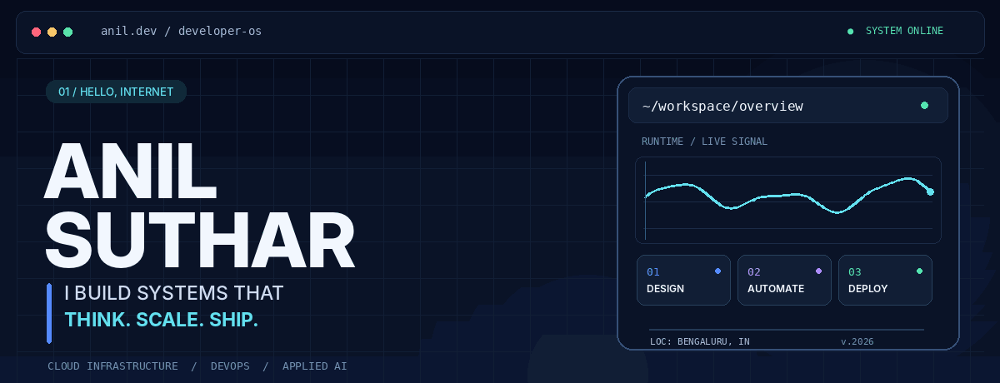
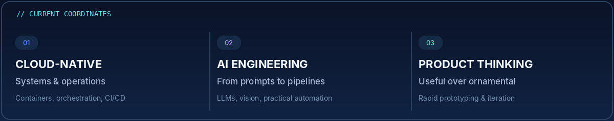
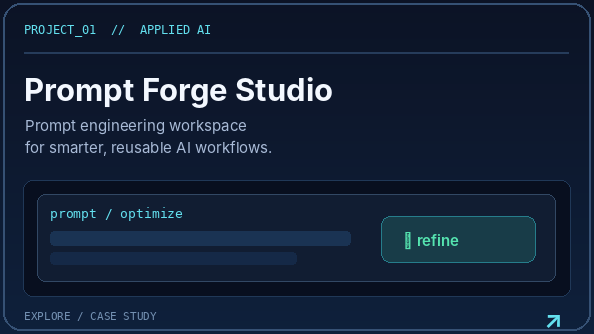
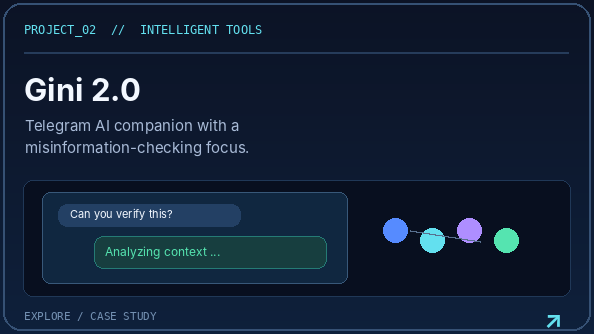
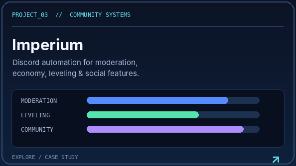
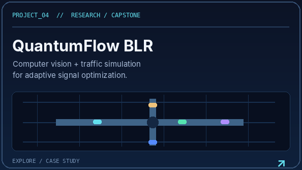
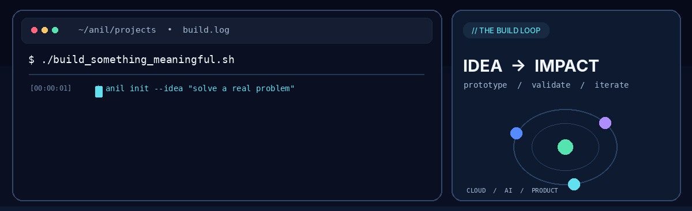

<!--
  ANIL.DEV / DEVELOPER OS
  All graphics in assets/ are custom-designed for this profile.
  Github README supports Markdown and safe HTML, not custom JavaScript or CSS.
-->

<div align="center">
  <a href="https://www.anilsuthar.tech/" title="Explore my portfolio">
    
  </a>
</div>

<!-- navigation bar -->
<div align="center">
  <a href="#about"></a>&nbsp;
  <a href="#work"></a>&nbsp;
  <a href="#stack"></a>&nbsp;
  <a href="#process"></a>&nbsp;
  <a href="#connect"></a>
</div>

<div align="center">
  <br />
  <a href="https://www.anilsuthar.tech/"></a>
  <a href="https://www.linkedin.com/in/sutharani738/"></a>
  <a href="https://github.com/ani12004?tab=repositories"></a>
  
</div>

<br />

<a id="about"></a>
## ◈ The person behind the terminal

<table>
<tr>
<td width="58%" valign="top">

### Hi, I'm Anil. I turn ideas into working systems.

I'm a **Computer Science student (Cloud Computing)** at **Alliance University, Bengaluru**, graduating in **2027**.

I work where **cloud infrastructure, DevOps, applied AI, and product engineering** meet. I'm drawn to problems that look chaotic at first: complex workflows, repetitive tasks, and systems that need to become simpler, faster, or more useful.

Currently an **AI Intern**, exploring generative AI, computer vision, and automation in real-world fashion and e-commerce workflows.

I don't just want the prototype to look impressive. I want the underlying system to make sense.

</td>
<td width="42%" valign="top">

```yaml
name: Anil Suthar
base: Bengaluru, India
education: B.Tech CSE / Cloud
focus:
  - Cloud & DevOps
  - AI Engineering
  - Automation
  - Product Building
status: learning + building
mindset: "build > test > improve"
```

</td>
</tr>
</table>

<div align="center">
  
</div>

<br />

<a id="work"></a>
## ◈ Selected work

*Prototypes, tools, experiments, and systems with a purpose.*

<table>
  <tr>
    <td width="50%" valign="top">
      <a href="https://github.com/ani12004/Prompt-Forge-Studio"></a>
      <br />
      <strong><a href="https://github.com/ani12004/Prompt-Forge-Studio">Prompt Forge Studio ↗</a></strong><br />
      <sub>Next.js · TypeScript · Gemini · Prompt engineering</sub>
    </td>
    <td width="50%" valign="top">
      <a href="https://github.com/ani12004/gini-2.0"></a>
      <br />
      <strong><a href="https://github.com/ani12004/gini-2.0">Gini 2.0 ↗</a></strong><br />
      <sub>Telegram · Gemini API · AI assistant</sub>
    </td>
  </tr>
  <tr>
    <td width="50%" valign="top">
      <a href="https://github.com/ani12004/Imperium"></a>
      <br />
      <strong><a href="https://github.com/ani12004/Imperium">Imperium ↗</a></strong><br />
      <sub>Discord · Moderation · Automation · Community tools</sub>
    </td>
    <td width="50%" valign="top">
      
      <br />
      <strong>QuantumFlow BLR / Capstone research</strong><br />
      <sub>Computer vision · SUMO · Adaptive traffic control · Optimization</sub>
    </td>
  </tr>
</table>

> **Note:** The project cards are original illustrations, not screenshots of the applications. The capstone is listed as research rather than linked to an unverified public repository.

<br />

<a id="stack"></a>
## ◈ Technology & toolbox

**LANGUAGES / APP DEVELOPMENT**

<p>
  
</p>

**CLOUD / PLATFORM ENGINEERING**

<p>
  
</p>

**CREATIVE COMPUTING / VISUAL TOOLS**

<p>
  
</p>

`LLM orchestration` · `Prompt engineering` · `Computer vision` · `Workflow automation` · `APIs` · `CI/CD` · `Simulation`

<br />

<a id="process"></a>
## ◈ The build loop

*An illustrated terminal sequence of how I approach engineering work, from a raw idea to something worth shipping.*

<div align="center">
  
</div>

<br />

## ◈ GitHub activity

<div align="center">
  <a href="https://github.com/ani12004?tab=overview"></a>
</div>

<!-- Snake is generated via .github/workflows/snake.yml after you enable/run GitHub Actions. -->
<div align="center">
  <a href="https://github.com/ani12004?tab=overview">
    <picture>
      <source media="(prefers-color-scheme: dark)" srcset="https://raw.githubusercontent.com/ani12004/ani12004/output/github-snake-dark.svg" />
      <source media="(prefers-color-scheme: light)" srcset="https://raw.githubusercontent.com/ani12004/ani12004/output/github-snake.svg" />
      
    </picture>
  </a>
</div>

<sub>Snake animation updates daily through GitHub Actions after the initial workflow run. Streak stats are supplied by a third-party service and may be temporarily unavailable.</sub>

<br />

<a id="connect"></a>
## ◈ Connect & collaborate

<div align="center">
  <a href="https://www.linkedin.com/in/sutharani738/"></a>
  <br />
  <a href="https://www.anilsuthar.tech/"></a>
  <a href="https://www.linkedin.com/in/sutharani738/"></a>
</div>

<div align="center">
  <sub>Designed as a developer interface, built for GitHub Markdown. No heavy scripts. Just thoughtful pixels and working links.</sub>
</div>
