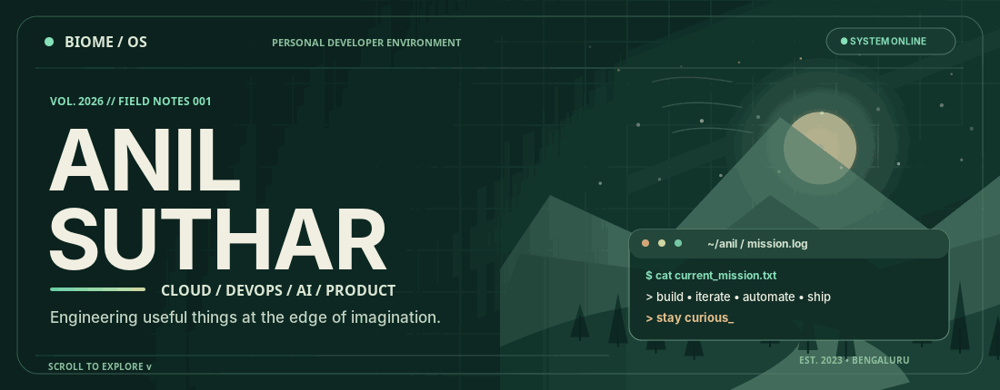
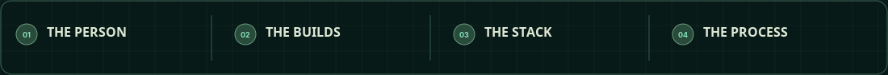
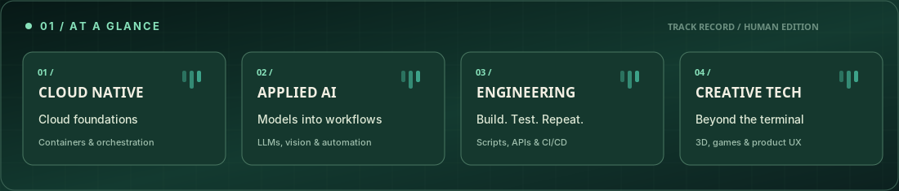
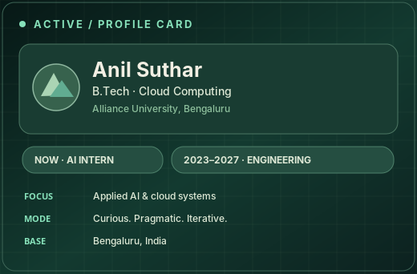
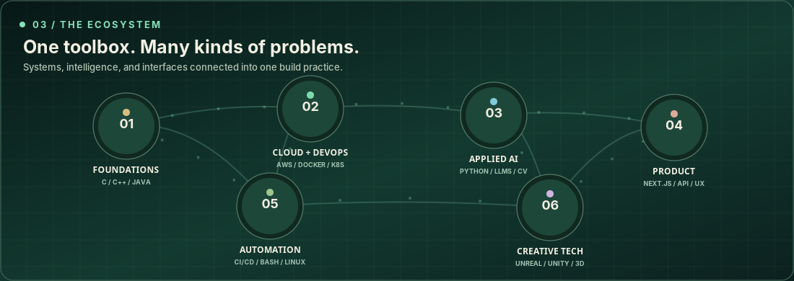
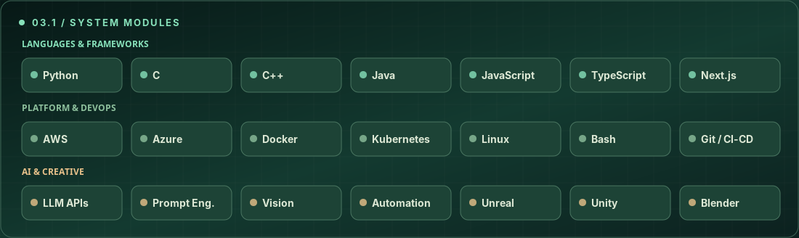
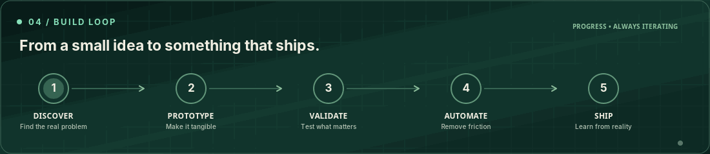
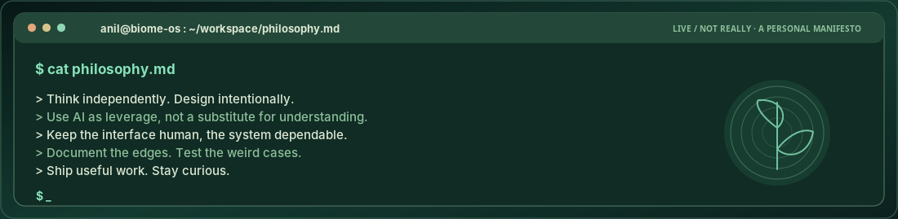
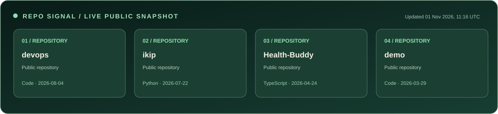
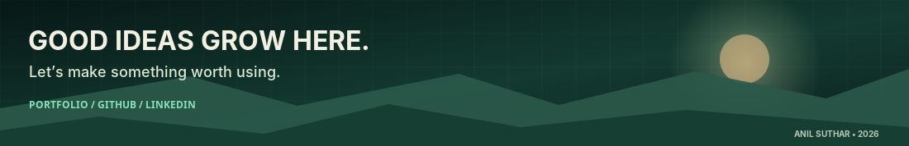

<!--
BIOME / OS  ·  Anil Suthar's GitHub profile
Designed as a nature-inspired developer interface that works inside GitHub README limitations.
Artwork is locally bundled, never hotlinked to a design mockup.
The SVG activity panel is optional and can be refreshed by the included GitHub Action.
-->

<div align="center">
  <a href="https://www.anilsuthar.tech/" title="Explore Anil's portfolio">
    
  </a>
</div>

<div align="center">
  <a href="#field-guide"></a>
  <a href="#selected-builds"></a>
  <a href="#the-ecosystem"></a>
  <a href="#the-build-cycle"></a>
  <a href="#connect"></a>
</div>

<div align="center">
  <a href="https://www.anilsuthar.tech/"></a>
  <a href="https://github.com/ani12004?tab=repositories"></a>
  <a href="https://www.linkedin.com/in/sutharani738/"></a>
</div>

<br>





## Field guide

<table>
  <tr>
    <td width="56%" valign="top">
      <h3>Hey, I'm Anil. I build things that make complexity useful.</h3>
      <p>I'm a <b>B.Tech Computer Science student specializing in Cloud Computing</b> at Alliance University, Bengaluru (2023–2027), and an <b>AI Intern</b> working across generative AI, computer vision and automation.</p>
      <p>I like projects where the infrastructure is thoughtful, the AI is practical and the interface is a pleasure to use. My interests range from cloud-native engineering and developer tools to creative coding, simulation and 3D experiences.</p>
      <p><b>Current direction:</b> building dependable AI-assisted workflows, scalable services and tools with real-world utility.</p>
      <blockquote>Good systems should be powerful under the hood and simple on the surface.</blockquote>
    </td>
    <td width="44%" valign="top">
      
    </td>
  </tr>
</table>

<details>
  <summary><b>✳ Open my developer coordinates</b> · what I'm exploring right now</summary>
  <br>
  <table>
    <tr><td><b>🌱 Currently learning</b></td><td>AI agents, LLM systems, orchestration and scalable infrastructure</td></tr>
    <tr><td><b>🔧 Favorite work</b></td><td>Engineering workflows, APIs, automation, developer tooling and applied vision</td></tr>
    <tr><td><b>🎨 Creative side</b></td><td>Unreal Engine, Unity, Blender and interactive products</td></tr>
    <tr><td><b>🤝 Collaborations</b></td><td>Open-source tools, product experiments and interesting engineering problems</td></tr>
  </table>
</details>

<br>

## Selected builds

> Some of the things I've shipped, researched or experimented with. The cards below are UI illustrations, not product screenshots.

<table>
  <tr>
    <td width="50%" valign="top">
      <a href="https://github.com/ani12004/Prompt-Forge-Studio"></a>
      <h3><a href="https://github.com/ani12004/Prompt-Forge-Studio">Prompt Forge Studio ↗</a></h3>
      A workspace for creating, refining and managing AI prompts, built with Next.js and Gemini integration.
      <br><br><code>Prompt Engineering</code> <code>Next.js</code> <code>Gemini</code>
    </td>
    <td width="50%" valign="top">
      <a href="https://github.com/ani12004/gini-2.0"></a>
      <h3><a href="https://github.com/ani12004/gini-2.0">Gini 2.0 ↗</a></h3>
      A Telegram AI companion with Gemini-powered conversation and a misinformation-checking focus.
      <br><br><code>Telegram</code> <code>Generative AI</code> <code>Automation</code>
    </td>
  </tr>
  <tr>
    <td width="50%" valign="top">
      <a href="https://github.com/ani12004/Imperium"></a>
      <h3><a href="https://github.com/ani12004/Imperium">Imperium ↗</a></h3>
      A multi-purpose Discord bot focused on moderation, community experiences and automation.
      <br><br><code>Discord Bot</code> <code>Community</code> <code>Automation</code>
    </td>
    <td width="50%" valign="top">
      
      <h3>QuantumFlow BLR · Capstone</h3>
      Research combining computer vision, traffic simulation and adaptive signal optimization using classical and quantum-inspired approaches.
      <br><br><code>Computer Vision</code> <code>SUMO</code> <code>Optimization</code>
    </td>
  </tr>
</table>

<div align="right"><a href="https://github.com/ani12004?tab=repositories"><b>Explore all public repositories ↗</b></a></div>

<br>

## The ecosystem





<details>
  <summary><b>⚙️ Open the full toolbox</b> · methods, frameworks and adjacent interests</summary>
  <br>

  | Layer | Working knowledge & interests |
  |:--|:--|
  | Foundations | C, C++, Java, Python, JavaScript, TypeScript |
  | Cloud & operations | AWS, Azure, Docker, Kubernetes, Linux, Bash, CI/CD |
  | Applied AI | LLMs, prompt engineering, computer vision, model/API integration |
  | Product engineering | Next.js, REST APIs, automation, rapid prototyping |
  | Creative development | Unreal Engine, Unity, Blender, Android Studio |

  I use AI-assisted coding to accelerate experiments, but still care deeply about testing, documentation, edge cases and maintainability.
</details>

<br>

## The build cycle

<div align="center">
  
</div>

<br>



<details>
  <summary><b>🧪 Read the lab notes</b> · what a prototype needs before it becomes a real product</summary>
  <br>

  ```text
  [ ] Can another developer run it without guessing?
  [ ] Does it fail loudly and recover safely?
  [ ] Are the important decisions documented?
  [ ] Are the real workflows tested, not just the demo?
  [ ] Does it meaningfully help the person using it?
  ```

  My favorite engineering work lives between a fast idea and the careful systems that make it reliable.
</details>

<br>

## Repository signal

<div align="center">
  
  <sub>Public repository snapshot · generated automatically when the included workflow is enabled. No visitor counters or fabricated metrics.</sub>
</div>

<br>

## Connect

<div align="center">
  
  <br><br>
  <a href="https://www.anilsuthar.tech/"></a>
  <a href="https://github.com/ani12004"></a>
  <a href="https://www.linkedin.com/in/sutharani738/"></a>
  <br><br>
  <sub>BIOME / OS · Designed to grow with the work · Nature-inspired graphics built specifically for this profile</sub>
</div>
