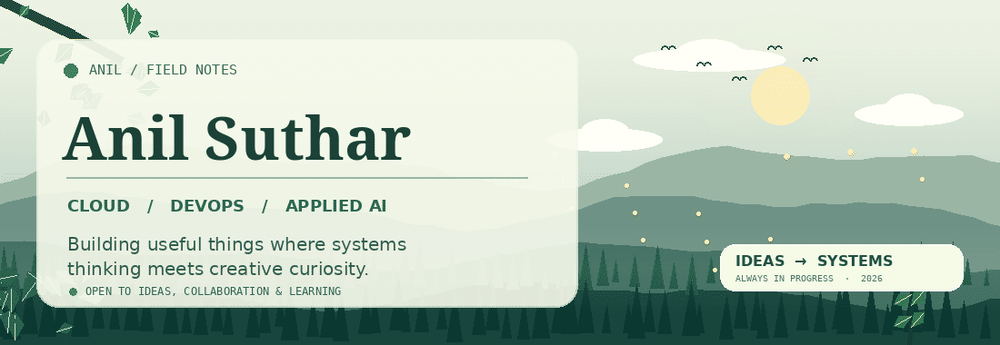
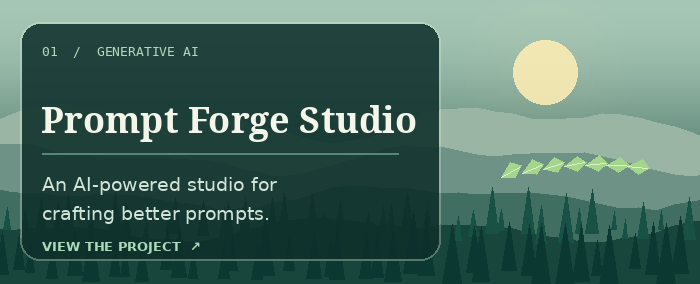
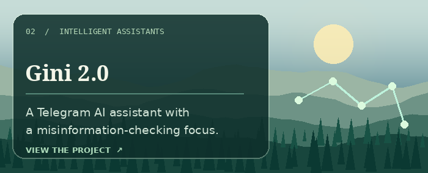
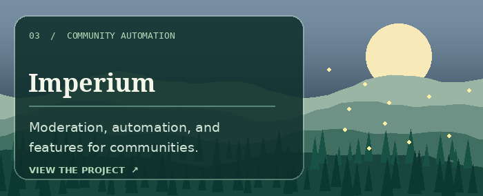
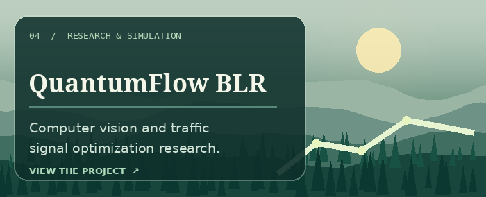
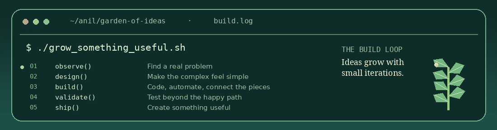
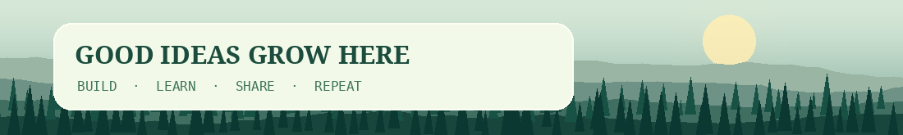

<!--
  THE GREENHOUSE | GitHub profile of Anil Suthar
  A nature-inspired developer landing page built with GitHub-safe HTML + Markdown.
  Custom animations and illustrations are self-hosted in ./assets/.
  Artwork is symbolic, not application screenshots or live telemetry.
-->

<div align="center">
  <a href="https://www.anilsuthar.tech/" title="Explore Anil's portfolio">
    
  </a>
</div>

<div align="center">
  <a href="#about-me"></a>
  <a href="#the-work"></a>
  <a href="#the-toolbox"></a>
  <a href="#the-build-loop"></a>
  <a href="#say-hello"></a>
</div>

<div align="center">
  <sub><b>LESS NOISE. MORE CURIOSITY. BETTER SYSTEMS.</b></sub>
  <br /><br />
  <a href="https://www.anilsuthar.tech/"></a>
  <a href="https://www.linkedin.com/in/sutharani738/"></a>
  <a href="https://github.com/ani12004?tab=repositories"></a>
</div>

<br />

<a id="about-me"></a>

### 🌿 A little about me

<table>
  <tr>
    <td width="62%" valign="top">
      <b>Hi, I'm Anil. I like turning complicated problems into useful tools.</b>
      <br /><br />
      I'm a <b>B.Tech Computer Science student</b> specializing in <b>Cloud Computing</b> at <b>Alliance University, Bengaluru</b> (2023–2027).
      <br /><br />
      My work lives where <b>cloud infrastructure, automation, generative AI, and product engineering</b> meet. I enjoy building systems that are thoughtful behind the scenes and simple to use on the surface.
      <br /><br />
      I'm currently working as an <b>AI Intern</b>, exploring applied LLMs, computer vision, and automation for real-world workflows. Outside that, I experiment with games, 3D tools, and ideas that might become products.
      <br /><br />
      <i>Curiosity is the starting point. Shipping something useful is the goal.</i>
    </td>
    <td width="38%" valign="top">
      <b>🌱 Currently growing</b>
      <br /><br />
      🌲 Cloud-native architecture
      <br /><br />
      🍃 AI agents &amp; automation
      <br /><br />
      🪴 Practical developer tools
      <br /><br />
      🌤️ Creative computing
      <br /><br />
      <code>location: Bengaluru, India</code><br />
      <code>status: learning + building</code><br />
      <code>mindset: iterate &gt; perfect</code>
    </td>
  </tr>
</table>

<br />

<a id="the-work"></a>

### 🍂 The work · Selected projects

<sub>Different problems, different experiments, same habit of building.</sub>

<br /><br />

<table>
  <tr>
    <td width="50%" valign="top">
      <a href="https://github.com/ani12004/Prompt-Forge-Studio"></a>
      <br /><b><a href="https://github.com/ani12004/Prompt-Forge-Studio">Prompt Forge Studio ↗</a></b>
      <br /><sub>Prompt engineering workspace with Next.js and Gemini integration.</sub>
    </td>
    <td width="50%" valign="top">
      <a href="https://github.com/ani12004/gini-2.0"></a>
      <br /><b><a href="https://github.com/ani12004/gini-2.0">Gini 2.0 ↗</a></b>
      <br /><sub>Telegram AI companion with a misinformation-checking focus.</sub>
    </td>
  </tr>
  <tr>
    <td width="50%" valign="top">
      <a href="https://github.com/ani12004/Imperium"></a>
      <br /><b><a href="https://github.com/ani12004/Imperium">Imperium ↗</a></b>
      <br /><sub>Multi-purpose Discord bot for moderation and community features.</sub>
    </td>
    <td width="50%" valign="top">
      
      <br /><b>QuantumFlow BLR · Capstone</b>
      <br /><sub>Computer vision, SUMO simulation, and adaptive traffic signal optimization research.</sub>
    </td>
  </tr>
</table>

<sub>Project illustrations are original symbolic artwork, not screenshots. The capstone has no public repository linked here.</sub>

<br /><br />

<a id="the-toolbox"></a>

### 🪴 The toolbox

<b>01 · Languages &amp; application development</b>

<p>
  
</p>

<b>02 · Cloud &amp; platform engineering</b>

<p>
  
</p>

<b>03 · Creative computing</b>

<p>
  
</p>

<code>Prompt engineering</code> · <code>LLM workflows</code> · <code>Computer vision</code> · <code>API integrations</code> · <code>CI/CD</code> · <code>Automation</code>

<br /><br />

<a id="the-build-loop"></a>

### 🌾 The build loop

<sub>Every good system starts small. Observe, design, build, validate, and keep improving.</sub>

<br /><br />

<div align="center">
  
</div>

<br />

<details>
  <summary><b>🌱 Open the greenhouse log</b> · a little more about how I work</summary>
  <br />

  ```text
  [ seed ]     find a problem worth solving
  [ roots ]    understand how the system works
  [ stem ]     prototype the smallest useful version
  [ leaves ]   test edge cases, improve, automate
  [ growth ]   share the result, learn, repeat
  ```

  I enjoy AI-assisted development, but I care about the parts that make a prototype real: reproducibility, testing, observability, useful UX, and maintainable code.
</details>

<br />

<a id="say-hello"></a>

<div align="center">
  
  <br /><br />
  <b>Have an interesting idea, open-source project, or engineering problem?</b>
  <br />
  I'm always happy to learn, collaborate, and build things that matter.
  <br /><br />
  <a href="https://www.anilsuthar.tech/"></a>
  <a href="https://www.linkedin.com/in/sutharani738/"></a>
  <a href="https://github.com/ani12004?tab=repositories"></a>
</div>

<div align="center">
  <br />
  <sub>🌲 Designed with a little nature and a lot of curiosity · Self-hosted animated artwork · Built for GitHub Markdown</sub>
</div>
